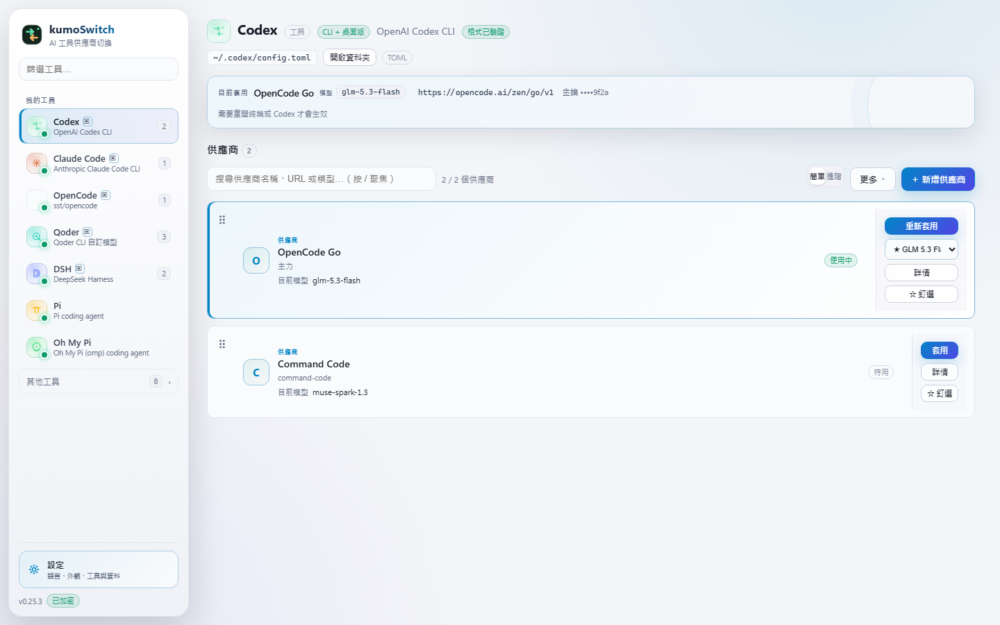
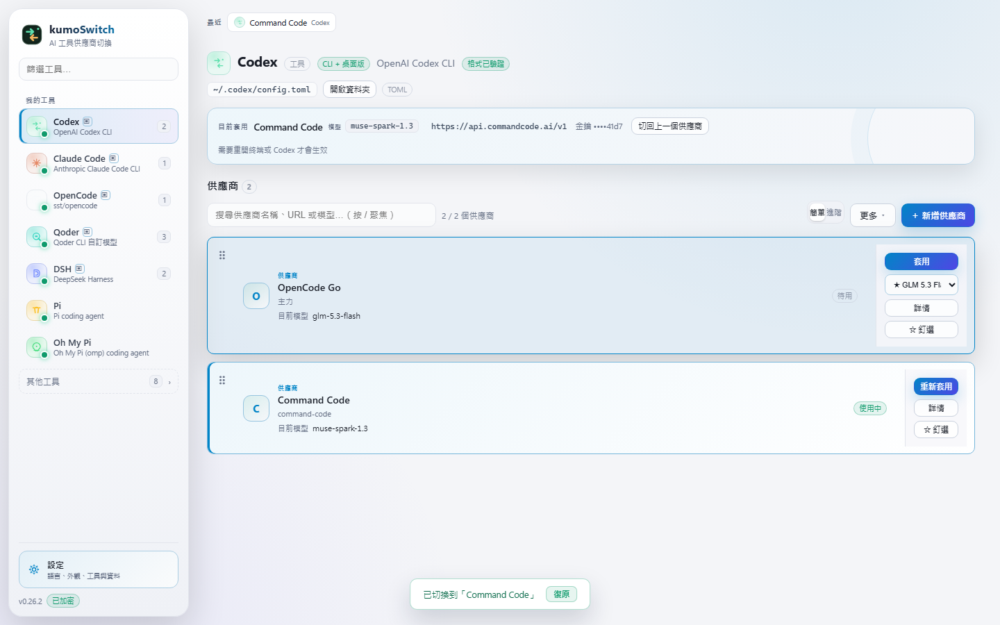

# kumoSwitch

[](https://github.com/cypwlp/kumoSwitch/releases)
[](LICENSE)

> 管理 AI Harness 供應商，CLI 與桌面版都不動其他一行設定。

> **2026-11-12 起更名：SwitchTower → kumoSwitch。** 更早版本名為 SwitchYard；舊資料、主題與語言設定會自動遷移，GitHub 舊網址由 GitHub 自動重新導向。

一個 Tauri 桌面工具，把 Codex、Claude Code、Gemini CLI、Grok Build、OpenCode、Qoder、DSH、ZCode、Hermes、Command Code、Crush、Qwen Code、Kilo Code、Pi、Oh My Pi 共 15 種 Harness 的供應商設定集中管理。介面同時標示 CLI、桌面版或兩者共用，並提供安全安裝與官方下載入口。



## 設計原則

kumoSwitch 專注在一件事：切換供應商時只改必要的設定鍵。簡單模式可一鍵切換，需要時再展開逐行 diff；寫入前一律建立時間戳備份，任何切換都能從通知一鍵復原。



## 核心特性

- **非破壞性寫入** —— 不經過序列化器重寫整份檔案。JSON 用自寫的語法樹定位位元組區間、TOML 用 `toml_edit` 保留格式，只替換目標值那一段文字。沒列進 diff 的內容一個位元組都不會變。
- **六種主題色** —— 海洋、極光、日落、森林、玫瑰、琥珀，可與暗色／亮色／系統模式自由搭配並記住選擇。
- **可選的變更預覽** —— 進階模式按下套用會先顯示「目前 → 套用後」的逐行差異；簡單模式預設直接套用，仍會建立備份並提供 9 秒通知復原與 `Ctrl+Z`。
- **自動備份與一鍵還原** —— 每次寫入前把要動的檔案複製到時間戳快照；快速切換的復原會直接還原剛建立的安全快照。
- **快速新增供應商** —— 可從 28 個供應商目錄選擇並自動填入 Base URL、模型與協議，貼上 API Key 即可；也可手動輸入，儲存後自動抓取 `/models` 並立即切換。
- **最近使用與釘選** —— 主畫面保留最近 5 個切換，常用供應商可釘選到最前面；系統托盤的切換也會同步到最近清單。
- **統計範圍與三維度** —— 下拉選擇今天／7／30／90／365 天；每日用量以輸入、輸出、快取命中堆疊顯示，並標記各工具固定開銷。
- **逐筆用量記錄** —— 統計頁可查看最近請求的時間、來源、模型、狀態、耗時與成本，最多保留 300 筆並可依來源／模型篩選。
- **搬家中心** —— 設定頁集中引導「備份 → 官方設定檔 → 選用相容匯入」三個步驟。
- **相容匯入（預設關閉）** —— 可在設定明確開啟後，唯讀取用本機 `cc-switch.db`，獨立列出其他切換工具管理的供應商與路由狀態；只讀、不上傳、不修改，逐項選取後才匯入。kumoSwitch 與任何第三方工具都沒有官方合作或背書關係。
- **接管狀態偵測** —— 偵測到其他代理工具正接管同一套設定時會提示，避免兩個工具互相覆蓋。
- **本機優先** —— 無帳號、無雲端、無遙測。設定與備份都在 `%APPDATA%\kumoSwitch`；清單與歷史採原子寫入，Unix 上資料目錄為 `0700`、應用檔案為 `0600`。
- **跨平台金鑰加密＋遮罩** —— Windows 使用 DPAPI；macOS／Linux 用 Keychain／Secret Service 保存隨機主金鑰，再以 AES-256-GCM 加密 `providers.json` 裡的金鑰。清單與 diff 只顯示末四碼，完整金鑰必須在編輯器按下「查看」才會載入，並於 30 秒後自動隱藏；複製後也會嘗試在 30 秒清空剪貼簿。舊的明文檔會自動遷移，安全儲存不可用時拒絕寫入明文。
- **清楚的三層資源模型** —— 介面固定依照 `Harness → 供應商 → 模型` 呈現：先選 Endpoint＋金鑰組成的供應商，再進入該供應商底下的模型，不把兩者混在同一層。
- **供應商 → 多模型管理** —— 每個供應商可保存多個模型，支援模型搜尋、單一展開編輯、context window、max output、reasoning／vision／tools 能力與自訂 metadata；可單獨切換模型並直接預覽 diff，不必改動整個供應商。\n- **模型資訊與思考等級** —— 自動從模型目錄 metadata 補齊 context window、最大輸出與所有可用 thinking levels；供應商未公開的欄位保留原值，思考等級則使用 Harness 候選。每個模型可保存自己的等級，切換模型會一併套用，並可在 Codex、Claude、OpenCode、Kilo、Pi、Oh My Pi 寫入實際設定。
- **逐模型健康度** —— 每個模型可獨立檢查 `/models` 是否列出該 ID，保存最近 20 次狀態與延遲；測試不會送 prompt，也不產生推論費用。
- **模型目錄搜尋** —— 新增模型可直接搜尋供應商 `/models` 回報的完整型號，選取後自動帶入 context window、max output 與思考等級；未儲存的新模型也能查詢，不會先寫入設定。
- **自動模型探索與同步** —— 從供應商的 `/models` 讀取可用模型，預覽新增、已存在與本次未回報項目；可選擇性合併名稱、context window 與能力資訊，且永不自動刪除既有模型。
- **模型同步 v3** —— 顯示欄位級差異並可逐欄更新；每個供應商可設定獨立同步間隔與隨機延遲，失敗採指數式退避，成功後重新排程。既有模型清單同時作為離線快取，未回報模型只會標記、永不自動刪除。
- **快速模型切換** —— 從供應商卡片、Ctrl+K、系統托盤直接切換模型；常用模型優先顯示，並可一鍵切回上一個模型。
- **設定守護中心 2.0** —— 背景以檔案指紋持續比對所有 Harness 的實際設定與 kumoSwitch 紀錄，辨識外部修改、未知供應商、金鑰與模型漂移；保留可歸因的變更時間線，支援批次操作與可選的自動修復。
- **跨 Harness 共用 Profile** —— 一份加密的 endpoint、金鑰與模型組合可同步到多個 Harness，各自保留相容的 protocol、config id 與模型映射。
- **模型能力與相容性矩陣** —— 檢查 context window、tool calling、reasoning、vision 與 protocol；明確不相容的組合會在套用前阻擋，並可用模型 metadata 明確覆寫。
- **API Key 生命週期** —— 每個供應商可管理多把加密輪替金鑰，支援到期日、低成本的 `/models` 測試、切換、刪除與本機稽核。
- **模型感知代理** —— 每個代理目標可設定允許模型與模型映射，讓相同請求跨供應商映射到各自的實際模型 ID。
- **代理觀測與告警** —— 顯示成功率、TTFB、換手、請求決策、常見失敗原因與 429／連續失敗／慢請求／熔斷告警，並可匯出不含 prompt／金鑰的診斷。
- **備份／遷移中心** —— 集中查看所有 Harness 的版本時間線、checksum、容量與排程快照；還原前自動建立安全快照，更新前也可選擇先備份。
- **一鍵導入與衝突預覽** —— 掃描所有 Harness 後先顯示新增／衝突項目，可保留本機、用設定檔覆蓋、合併模型或建立副本。
- **連線測試與模型實測** —— `/models` 檢查不會產生推論費用；真實實測需明確確認，支援多模型批次、近 24 小時配額、硬性輸出 token 上限與 provider pricing metadata 費用粗估。
- **加密清單備份** —— 換機時用 Argon2id＋AES-256-GCM 加密的 `.kumoswitch` 檔搬移供應商與金鑰；仍可匯入舊版明文 JSON。
- **Harness 圖標與介面範圍** —— 左側 15 個 Harness 都有原創 SVG／色系圖標；每個 adapter 明確標示 CLI、桌面版或兩者共用，避免把「有桌面產品」誤說成「桌面設定已支援」。
- **系統托盤常駐** —— 托盤右鍵可直接切換任一工具的任何供應商，並列出最近使用的 5 個；關窗不退出，單一實例。
- **Ctrl+K 命令面板** —— 跨 15 個工具搜尋供應商，Enter 直接看 diff。
- **首次啟動引導** —— 自動偵測既有設定並一鍵導入，不必從零輸入。
- **診斷匯出與回饋精靈** —— 一鍵產生環境與設定摘要（金鑰只留末四碼）；回饋精靈可在預覽後複製或開啟 GitHub Issue，绝不自動上傳。
- **自動健康檢查** —— 可開啟每 10 分鐘重測已有歷史的供應商，健康度欄不用手動按。
- **統計儀表板** —— 串流讀取 Claude Code、Codex、Pi、Oh My Pi、DSH 的本機用量記錄，計算 token、每日趨勢與成本估算；可依來源與模型篩選，並在 log 有時間欄位時顯示平均回應時間、P50 有效吞吐、慢請求數與首字延遲估算。速度以迴歸估算解碼速率並分離固定等待，不再把首字等待誤算成模型變慢。掃描在背景執行，並顯示實際檢查路徑、讀取檔案數、跳過數與錯誤診斷。其他工具目前沒有穩定的本機 token 格式，會明確標示而不會憑空估算。
- **供應商目錄** —— 28 個供應商 endpoint 與模型起點，支援名稱／網址／模型搜尋、帳號登入／模型廠商／第三方／雲服務／本機／跨應用分類、雙欄卡片與自訂配置。
- **Harness 安裝與管理** —— 設定頁可查看是否偵測到 CLI／設定目錄、執行白名單內的固定 npm 安裝命令，或前往桌面版官方下載頁。安裝前會顯示完整命令，不經 shell、不執行任意下載腳本。
- **即時切換** —— 工具頁一鍵啟用；目前對話重開一次後，之後切換上游立即生效，不必再改工具設定。
- **一鍵代理模式** —— 把工具指向 kumoSwitch 本機代理並自動註冊所有供應商；之後切換上游只改路由，目前 session 不需重啟即可走新供應商，並保留原網址。
- **智慧代理／故障轉移** —— 本地反向代理支援固定順序、優先級、加權與健康優先路由；每個供應商可設定 timeout、429 退避、熔斷、最大併發、允許模型與模型映射，並提供成功率、TTFB、換手、脫敏失敗原因與每請求決策軌跡（候選順序、跳過原因、逾時與熔斷狀態）。共用連線池、32 MiB body 上限與真正即時 flush 的 SSE 串流。
- **跨平台** —— Windows／Linux／macOS 皆由 CI 建置，main 每次推送跑三平台測試。
- **第三方授權與簽章流程** —— `THIRD-PARTY-NOTICES.md` 列出 npm／Rust 依賴授權；`RELEASING.md` 記錄 Windows Authenticode、macOS 公證與 Tauri updater secrets 的設定方式。
- **跨平台自動更新** —— Windows 安裝版、macOS Apple Silicon／Intel 與 Linux AppImage 共用一份簽章驗證的 `latest.json`；可攜版與 Linux deb 仍建議手動替換。

## 支援的工具

| 工具 | 設定介面 | 設定檔 | 寫入的鍵 | 驗證狀態 |
| --- | --- | --- | --- | --- |
| Codex | CLI + 桌面版 | `~/.codex/config.toml` | `model_provider`、`model`、`[model_providers.*]` | 已對真實設定檔驗證 |
| Claude Code | CLI + 桌面版 | `~/.claude/settings.json` | `env.ANTHROPIC_BASE_URL` / `_AUTH_TOKEN` / `_MODEL` | 已對真實設定檔驗證 |
| Gemini CLI | CLI | `~/.gemini/settings.json` + `.env` | `selectedAuthType`、`model.name`、`GOOGLE_GEMINI_BASE_URL`、`GEMINI_API_KEY` | 依官方文件 |
| Grok Build | CLI | `~/.grok/config.toml` | `[model.*]`、`[models].default` | 依官方文件 |
| OpenCode | CLI + 桌面版 | `~/.config/opencode/opencode.json` | `provider.*.options`、頂層 `model` | 依官方文件 |
| Qoder | CLI + 桌面版 | `~/.qoder/settings.json` | `providers.<qoder-custom-*>` | 已對真實設定檔驗證 |
| DSH | CLI + 桌面版 | `~/.dsh/settings.yaml` | `llm-pi-ai.providers.*`、`agent-default-model` | 已對真實設定檔驗證 |
| ZCode | CLI + 桌面版 | `~/.zcode/v2/provider_config.json` | `providerRules[]`、`defaultModelSelection` | 對社群範例驗證 |
| Hermes | CLI + 桌面版 | `~/.hermes/config.yaml` | `providers.*.api/key`、`model.provider` | 對社群範例驗證 |
| Command Code | CLI（桌面版另有官方入口） | `~/.commandcode/providers.json` | `provider.*`（單數） | 對社群範例驗證 |
| Crush | CLI | `~/.config/crush/crush.json` | `providers.*` | 依官方文件 |
| Qwen Code | CLI + 桌面版 | `~/.qwen/settings.json` + `.env` | `modelProviders.*`、`OPENAI_*` | 對官方文件驗證 |
| Kilo Code | CLI | `~/.config/kilo/kilo.jsonc` | `provider.*.options` | 對官方範例驗證 |
| Pi | CLI | `~/.pi/agent/models.json` + `settings.json` | `providers.*`、`defaultProvider`、`defaultModel` | 依官方 schema 驗證 |
| Oh My Pi (omp) | CLI | `~/.omp/agent/models.yml` + `config.yml` | `providers.*`、`modelRoles.default` | 依官方 schema 驗證 |

15 個工具的寫入邏輯都有 fixture 測試：直接拿官方／社群的範例設定檔跑一遍，驗證目標鍵寫對、且使用者自訂的模型 metadata 不被覆蓋。

## 下載

使用 [專屬安裝向導](https://cypwlp.github.io/kumoSwitch/install.html?v=0.28.5) 自動選擇平台，或直接到 [Releases](https://github.com/cypwlp/kumoSwitch/releases) 取得：

- Windows 10／11 x64：NSIS 安裝檔，或免安裝的 `kumoSwitch-portable.exe`
- macOS Apple Silicon／Intel：`.dmg`
- Linux x64：`.AppImage` 或 `.deb`
- Release 流程會自動產生並附加 `SHA256SUMS.txt`

目前公開版本是**未簽章 Beta**。Windows 可能顯示 SmartScreen「未知發行者」，macOS 可能顯示 Gatekeeper 警告；請只從本專案 Releases 下載並核對 SHA-256。Windows 需要 WebView2（Win11 內建；Win10 多半已隨 Edge 安裝）。

## 從原始碼建置

```bash
npm install                  # @tauri-apps/cli
npm install --prefix ui      # React / Vite / TypeScript
npm run build                # 先建置前端，再產出 exe 與 NSIS 安裝檔
```

需要 Rust stable、Node 20+，以及 Windows 的 MSVC 建置工具（GNU toolchain 亦可編譯，本機已實測）。

只跑前端開發伺服器：`npm run ui:dev`。加上 `?mock=1` 可在一般瀏覽器預覽介面而不啟動 Tauri。

瀏覽器 E2E：先執行 `npx playwright install chromium`，再跑 `npm run e2e`。

## 專案結構

```
src-tauri/src/
  adapters.rs    每個工具的宣告式步驟表（檔案 / 格式 / 鍵路徑 / 值）
  jsonc.rs       保留格式的 JSON / JSONC 定點編輯器
  yamlpatch.rs   行導向的 YAML 編輯器
  backup.rs      時間戳快照、排程、集中版本樹與安全還原
  secure_fs.rs   原子寫入與私有檔案權限
  net.rs         連線與逐模型 /models 檢查
  compat.rs      Harness 模型能力與相容性矩陣
  keys.rs        API Key 輪替、到期與稽核
  profiles.rs    跨 Harness 共用供應商 Profile
  guardian.rs    背景設定守護、來源歸因、時間線與自動修復
  harness_manager.rs  CLI／桌面介面中繼資料、白名單安裝命令與官方入口
  proxy.rs       本機反向代理、智慧路由、熔斷、告警與觀測
  export_crypto.rs  Argon2id / AES-256-GCM 加密備份
  audit.rs       敏感操作稽核紀錄
  store.rs       供應商清單、模型選擇與排序（本機）
  main.rs        Tauri 指令層
ui/              React 18 + Vite + TypeScript 介面
site/            GitHub Pages 落地頁
```

技術棧：**Rust + Tauri 2**（WebView2 原生視窗）、`toml_edit`、`serde_json`、`similar`（diff）、
`windows-sys`（DPAPI）、`keyring`（Keychain／Secret Service）、`aes-gcm`、`argon2`；前端 **React 18 + Vite + TypeScript**，樣式為手寫 CSS 變數，無 CSS 框架。E2E 使用 **Playwright**。

想加一個新工具，通常只要在 `adapters.rs` 的 `TOOLS` 加一筆宣告，不需要寫新的寫入邏輯。

## 測試

```bash
cd src-tauri
cargo test
```

Windows 103、macOS／Linux 另含平台金鑰與檔案權限測試；另有 38 個 Playwright Chromium UI E2E，以及可在 Windows 建置產物上執行的真實 Tauri WebView E2E。主要涵蓋：

1. **編輯器單元測試** —— 註解、縮排、跳脫字元、任意縮排寬度是否保留。
2. **真實設定檔唯讀檢查** —— 直接讀本機現有的 Codex／Claude／Qoder／DSH 設定，驗證 `[desktop]`、`[plugins.*]`、`[mcp_servers.*]`、既有 provider 全部零改動。
3. **沙箱端到端測試** —— 在暫存目錄真的寫檔再讀回，涵蓋「重複套用冪等」「從無到有建立設定」「Gemini 雙檔寫入」「重新套用不覆蓋自訂 `models[]`／`compat`」。
4. **代理端到端故障轉移與 SSE** —— 本機啟動 500／200 上游與代理監聽器，驗證策略排序、timeout、熔斷、最大併發、5xx／連線失敗換手、header／method 轉發、client 重用、413 body 上限，以及 SSE 先送達與多條並行串流互不串線。
5. **金鑰與儲存安全** —— Windows 驗證 DPAPI；macOS／Linux 驗證 AES-GCM、原子寫入與 `0700/0600` 權限；另測 Argon2id／AES-256-GCM 備份往返、錯誤密碼與 malformed envelope。
6. **Playwright UI E2E** —— 驗證模型同步欄位差異、設定漂移中心、模型實測費用警告、供應商卡片與 Ctrl+K 模型切換、API Key 安全、代理模型映射、窄視窗、視覺回歸、匯入衝突與加密備份流程。

## 授權

MIT。本專案與 OpenAI、Anthropic、Google、xAI、Z.ai、Nous Research、Cloudflare 等公司無關；文中第三方產品名稱與商標屬各自所有者。安全問題請依 [SECURITY.md](SECURITY.md) 私下回報。


## 發行通道

- **Stable**：`vX.Y.Z` tag，產生 `latest.json`，不標記 prerelease。
- **Beta**：`vX.Y.Z-beta.N` tag，產生 `latest-beta.json` 並標記 prerelease；App 的設定頁可切換通道並開啟對應安裝向導。
- Release workflow 會先驗證三平台產物、updater 簽章、SHA-256、必需平台與 manifest，再公開 draft release；同時產生 GitHub build provenance attestation。
- 更新前備份預設開啟；安裝失敗或需要回復時，可從「備份／遷移中心」還原最近的更新前快照。

## 簽章（目前未啟用）

目前公開版本不做 Windows Authenticode、macOS Developer ID 或公證，因此可能出現 SmartScreen／Gatekeeper 警告。這是未簽章 Beta 的預期行為。

CI 仍保留可選的 Windows Authenticode hook：提供 `WINDOWS_CERT_PFX_BASE64` 與 `WINDOWS_CERT_PASSWORD` 時，會在 Tauri 打包前先簽好執行檔與安裝檔，避免破壞 updater 簽章。macOS 也可用 `APPLE_CERTIFICATE`、`APPLE_CERTIFICATE_PASSWORD`、`APPLE_SIGNING_IDENTITY`、`APPLE_ID`、`APPLE_PASSWORD`、`APPLE_TEAM_ID` 啟用 Developer ID 與公證。Tauri updater 的 minisign 驗證與 OS 簽章是兩件事。

## 鏡像站

主要網站是 [GitHub Pages](https://cypwlp.github.io/kumoSwitch/)。鏡像 origin 預留在
`kumoswitch.cypilu.cloud`，DNS 指向獨立的 Nginx virtual host，不會覆蓋同一台主機上的其他站點。

目前 origin 已部署並可從主機內以 `Host: kumoswitch.cypilu.cloud` 正確取得 kumoSwitch 頁面；但公開入口仍被
DNSPod／ICP 備案攔截，因此在完成網域備案或改由境外 CDN／反向代理承接前，不會放上官網下載頁。
